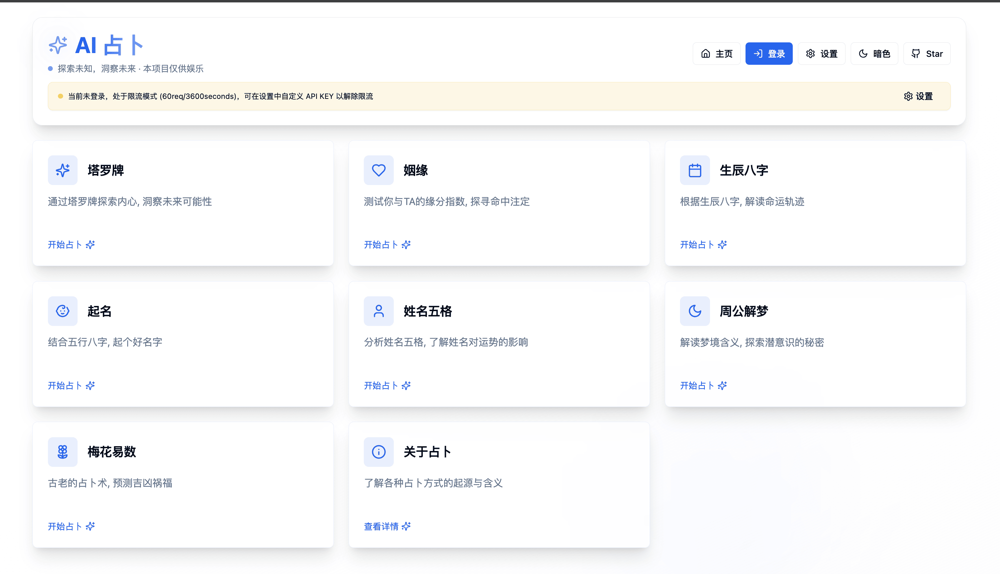

# AI 占卜 - ChatGPT Tarot Divination

基于 ChatGPT 的 AI 算命、占卜应用，支持多种占卜方式，提供流式输出体验和历史记录管理。



## 功能列表

- [x] **塔罗牌占卜** - 通过塔罗牌探索内心，洞察未来可能性
- [x] **生辰八字** - 根据出生时间分析命理运势
- [x] **姓名五格** - 通过姓名笔画分析性格和命运
- [x] **周公解梦** - 解析梦境含义，探索潜意识
- [x] **起名取名** - 根据生辰八字和五行推荐吉祥名字
- [x] **梅花易数** - 传统易学占卜方法
- [x] **姻缘占卜** - 分析感情运势和姻缘走向 [@alongLFB](https://github.com/alongLFB)

**特色功能**：
- 🌊 流式输出 - AI 占卜结果以打字机效果实时呈现
- 📚 历史记录 - 每种占卜类型自动保存最近 10 条记录
- 📱 响应式设计 - 完美适配手机、平板、电脑
- 🌙 暗色模式 - 支持明暗主题切换

---

## 四种部署方式

### 方式一：Vercel 一键部署（推荐）⭐

最简单快捷的部署方式，无需服务器，完全免费。

1. 点击下方按钮开始部署：

   [](https://vercel.com/new/clone?repository-url=https%3A%2F%2Fgithub.com%2Fdreamhunter2333%2Fchatgpt-tarot-divination&env=api_key,api_base&project-name=ai-divination&repository-name=ai-divination&demo-title=AI%20Divination&demo-description=AI%20Divination&demo-url=https%3A%2F%2Fdivination.app.awsl.uk)

2. 在部署时配置环境变量：
   - `api_key`：必填，你的 OpenAI API Key
   - `api_base`：可选，API 地址（默认为 OpenAI 官方地址）
   - 其他可选参数：`model`、`github_client_id`、`github_client_secret` 等

3. 部署完成后，Vercel 会自动分配一个访问域名

4. 也可以绑定自己的域名

### 方式二：下载 EXE 安装包（Windows 用户）

1. [点击下载 EXE 安装包](https://github.com/dreamhunter2333/chatgpt-tarot-divination/releases/tag/latest)
2. 安装并运行程序
3. 在设置中配置：
   - API BASE URL（OpenAI API 地址）
   - API KEY（你的 API 密钥）
4. 返回主页即可开始使用

### 方式三：Docker 部署

创建 `docker-compose.yml` 文件：

```yaml
services:
  chatgpt-tarot-divination:
    image: ghcr.io/dreamhunter2333/chatgpt-tarot-divination:latest
    container_name: chatgpt-tarot-divination
    restart: always
    ports:
      - 8000:8000
    environment:
      - api_key=sk-xxx                    # 必填：OpenAI API Key
      # - api_base=https://api.openai.com/v1  # 可选：API 地址
      # - model=gpt-3.5-turbo              # 可选：模型名称
      # - rate_limit=10/minute             # 可选：速率限制
      # - user_rate_limit=600/hour         # 可选：用户速率限制
      - github_client_id=xxx               # 可选：GitHub OAuth
      - github_client_secret=xxx           # 可选：GitHub OAuth
      - jwt_secret=secret                  # 可选：JWT 密钥
      - ad_client=ca-pub-xxx               # 可选：广告客户端
      - ad_slot=123                        # 可选：广告位
```

启动服务：

```bash
docker-compose up -d
```

访问 `http://localhost:8000` 即可使用。

### 方式四：本地运行（开发者）

**前置要求**：
- Node.js 22+
- Python 3.11+
- pnpm

**步骤**：

1. **创建配置文件** - 在项目根目录创建 `.env` 文件：

```bash
api_key=sk-xxxx                         # 必填：OpenAI API Key
api_base=https://api.openai.com/v1      # 可选：API 地址
model=gpt-3.5-turbo                     # 可选：模型
api_style=chat                          # 可选：chat | responses（推理模型如 gpt-6-luna 需 responses）
api_temperature=0.9                     # 可选：仅 chat 接口生效
api_reasoning_effort=                   # 可选：仅 responses 接口生效，留空用模型默认（none 并非所有模型都支持）
api_max_output_tokens=4000              # 可选：仅 responses 接口生效，含推理 token
github_client_id=xxx                     # 可选：GitHub OAuth
github_client_secret=xxx                 # 可选：GitHub OAuth
ad_client=ca-pub-xxx                     # 可选：广告客户端
ad_slot=123                              # 可选：广告位
```

2. **构建前端**：

```bash
cd frontend
pnpm install
pnpm build --emptyOutDir
cd ..
```

3. **部署前端文件**：

```bash
rm -r dist
cp -r frontend/dist/ dist
```

4. **安装并运行后端**：

```bash
python3 -m venv ./venv
./venv/bin/python3 -m pip install -r requirements.txt
./venv/bin/python3 main.py
```

5. **访问应用** - 打开浏览器访问 `http://localhost:8000`

---

## License

MIT License
